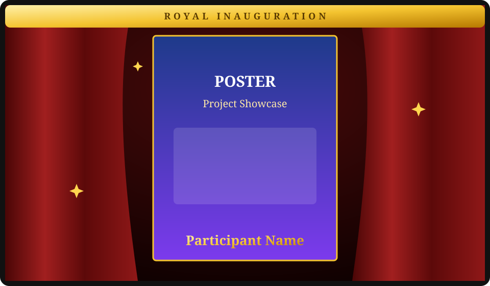
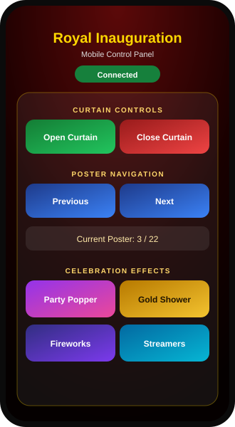
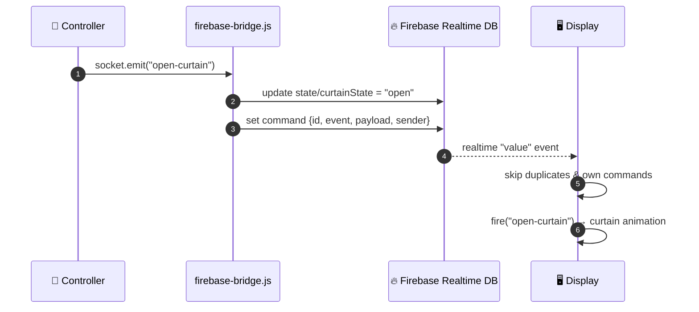

<div align="center">


<br>

### A real-time digital curtain, poster gallery and celebration show — controlled from your phone.

<br>

[](https://pratuwakchaure22.github.io/Royal-Inaguration-System/)
[](https://firebase.google.com/docs/database)
[](https://pages.github.com/)
[](#-tech-stack)
[](LICENSE)


[**Live Demo**](https://pratuwakchaure22.github.io/Royal-Inaguration-System/) ·
[**Quick Start**](#-quick-start) ·
[**Architecture**](docs/ARCHITECTURE.md) ·
[**Report Bug**](../../issues/new?template=bug_report.md) ·
[**Request Feature**](../../issues/new?template=feature_request.md)

</div>

---

## 📑 Table of Contents

| # | Section | # | Section |
|---|---------|---|---------|
| 1 | [Overview](#-overview) | 8 | [Controls Reference](#-controls-reference) |
| 2 | [Preview](#-preview) | 9 | [Customization](#-customization) |
| 3 | [Features](#-features) | 10 | [Firebase Data Model](#-firebase-data-model) |
| 4 | [How It Works](#-how-it-works) | 11 | [Security](#-security) |
| 5 | [Tech Stack](#-tech-stack) | 12 | [Troubleshooting](#-troubleshooting) |
| 6 | [Project Structure](#-project-structure) | 13 | [Roadmap](#-roadmap) |
| 7 | [Quick Start](#-quick-start) | 14 | [Contributing & License](#-contributing) |

---

## 🎭 Overview

**Royal Inauguration System** turns any large screen — laptop, projector or smart board — into a ceremonial stage. Your phone becomes the remote control: open a royal curtain, reveal posters one by one with the participant's name, and fire celebration effects at exactly the right moment.

It consists of two web pages kept in sync by **Firebase Realtime Database**. There is **no custom server, no build step and nothing to install** — everything runs from static hosting such as **GitHub Pages**.

| | Page | Runs on | Role |
|---|------|---------|------|
| 🖥️ | `display.html` | Laptop / projector | Shows the curtain, posters, names and effects |
| 📱 | `controller.html` | Smartphone | Remote control for the display |
| 🏠 | `index.html` | Any | Landing page linking to both |

---

## 🖼️ Preview

<div align="center">
<table>
<tr>
<td align="center" width="62%"><br><sub><b>🖥️ Display</b> — curtain, poster and participant name</sub></td>
<td align="center" width="38%"><br><sub><b>📱 Controller</b> — touch-friendly remote</sub></td>
</tr>
</table>

<sub>Illustrative previews. Replace them with real screenshots in <code>docs/images/</code> to show your own event.</sub>
</div>

---

## 🚀 Features

| | Feature | Details |
|---|---------|---------|
| 🎭 | **Animated royal curtain** | Smooth open/close with golden pulse and flash |
| 🖼️ | **Poster gallery** | 22 posters with participant names — easy to extend |
| 🔁 | **Seamless navigation** | Next / Previous automatically close → swap → reopen |
| 🎊 | **4 celebration effects** | Party Popper · Gold Shower · Fireworks · Streamers |
| 📱 | **Mobile-first controller** | Large touch buttons and live connection status |
| ⚡ | **Real-time sync** | Commands reach the display almost instantly |
| 🔄 | **State recovery** | Refresh the display and it restores curtain and poster |
| ☁️ | **Serverless** | Static files + Firebase — free to host |
| 🧩 | **Socket.IO-style API** | `socket.on()` / `socket.emit()` built on Firebase |

---

## ⚙️ How It Works

The controller never talks to the display directly. Both connect to the same Firebase database, and a small compatibility layer (`firebase-bridge.js`) exposes a familiar Socket.IO-like `io()` API.



> **Command vs. state** — a *command* is an action ("open now") that triggers animations. *State* is the current condition ("curtain is open") that lets a reloaded display recover.

📘 Full internals: [**docs/ARCHITECTURE.md**](docs/ARCHITECTURE.md)

---

## 🧰 Tech Stack

| Layer | Technology |
|-------|-----------|
| Markup & styling | HTML5 · CSS3 (transforms, transitions, gradients) |
| Logic | Vanilla JavaScript (ES6) · Canvas API |
| Realtime backend | Firebase Realtime Database (SDK 10.12.5, compat) |
| Hosting | GitHub Pages |
| Automation | GitHub Actions (CI + deploy) |
| Tooling | Node.js ≥ 18 (optional, for `npm start` / `npm run validate`) |

---

## 📂 Project Structure

```text
Royal-Inauguration-System/
├── src/                              # 🌐 The deployable website
│   ├── index.html                    #    Landing page
│   ├── display.html                  #    Big-screen stage
│   ├── controller.html               #    Mobile remote
│   └── assets/
│       ├── css/
│       │   ├── index.css
│       │   ├── display.css           #    Curtain, stage, poster styles
│       │   └── controller.css
│       ├── js/
│       │   ├── firebase-config.js          # Your Firebase project config
│       │   ├── firebase-config.example.js  # Config template
│       │   ├── firebase-bridge.js          # Socket.IO-style layer over Firebase
│       │   ├── gallery.js                  # ★ Poster list & names — edit this
│       │   ├── display.js                  # Curtain logic, effects, canvas
│       │   └── controller.js               # Buttons & connection status
│       └── images/posters/           #    poster-01 … poster-22
│
├── firebase/
│   └── database.rules.json           # 🔒 Recommended security rules
├── docs/
│   ├── ARCHITECTURE.md               # Technical deep dive
│   ├── FIREBASE_SETUP.md             # Step-by-step Firebase guide
│   └── images/                       # Banner & previews
├── scripts/
│   └── validate.js                   # Project checker (npm run validate)
├── .github/
│   ├── workflows/ci.yml              # Validate on every push / PR
│   ├── workflows/pages.yml           # Deploy src/ to GitHub Pages
│   ├── ISSUE_TEMPLATE/               # Bug & feature templates
│   └── PULL_REQUEST_TEMPLATE.md
├── package.json
├── CHANGELOG.md · CONTRIBUTING.md · CODE_OF_CONDUCT.md · SECURITY.md
├── LICENSE                           # MIT
└── README.md
```

---

## 🏁 Quick Start

### Prerequisites

- A modern browser (Chrome, Edge, Firefox, Safari)
- A free [Firebase](https://console.firebase.google.com/) account
- *(Optional)* Node.js ≥ 18 for the local dev server

### 1️⃣ Clone

```bash
git clone https://github.com/pratuwakchaure22/Royal-Inaguration-System.git
cd Royal-Inaguration-System
```

### 2️⃣ Connect your Firebase project

<details>
<summary><b>Click to expand the 5-minute setup</b></summary>

1. [Firebase Console](https://console.firebase.google.com/) → **Add project**
2. **Build → Realtime Database → Create database** (start in *locked mode*)
3. **Rules** tab → paste [`firebase/database.rules.json`](firebase/database.rules.json) → **Publish**
4. **Project settings → Your apps → Web (`</>`)** → copy the config
5. Paste it into [`src/assets/js/firebase-config.js`](src/assets/js/firebase-config.js) (template: `firebase-config.example.js`)

Detailed walkthrough: [docs/FIREBASE_SETUP.md](docs/FIREBASE_SETUP.md)

</details>

> The repo ships with a working demo configuration. Use your own project for real events.

### 3️⃣ Run locally

```bash
npm start
# → http://localhost:8000
```

No Node? Use `python -m http.server 8000 --directory src` instead.

### 4️⃣ Deploy to GitHub Pages

1. Push the repository to GitHub
2. **Settings → Pages → Build and deployment → Source: GitHub Actions**
3. Every push to `main` deploys `src/` automatically
4. Your site goes live at `https://<username>.github.io/<repository>/`

### 5️⃣ Run the ceremony

1. **Laptop / projector** → open `display.html`, press **F11** for full screen
2. **Phone** → open `controller.html`, wait for 🟢 **Connected**
3. Tap **Open Curtain** and enjoy the show

> 💡 Both devices only need internet access to reach Firebase — they don't have to share a Wi-Fi network.

---

## 🎮 Controls Reference

| Button | Event sent | What happens on the display |
|--------|-----------|-----------------------------|
| 🎭 **Open Curtain** | `open-curtain` | Curtain opens with a golden flash |
| 🔒 **Close Curtain** | `close-curtain` | Curtain closes, all effects stop |
| ⬅ **Previous** | `prev-image` | Close → show previous poster → reopen |
| **Next** ➡ | `next-image` | Close → show next poster → reopen |
| 🎊 **Party Popper** | `celebrate: confetti` | Confetti burst |
| ✨ **Gold Shower** | `celebrate: gold` | Falling golden particles |
| 🎆 **Fireworks** | `celebrate: fireworks` | Firework explosions |
| 🎉 **Streamers** | `celebrate: streamers` | Colourful streamers |

---

## 🛠️ Customization

<details open>
<summary><b>➕ Add or change posters</b></summary>

1. Copy the image into `src/assets/images/posters/`
2. Register it in [`src/assets/js/gallery.js`](src/assets/js/gallery.js):

```js
window.GALLERY_IMAGES = [
  { src: "assets/images/posters/poster-01.jpeg", name: "" },
  { src: "assets/images/posters/poster-23.jpg",  name: "New Participant" }
];
```

The controller's poster counter updates automatically. Run `npm run validate` to confirm every file exists.

</details>

<details>
<summary><b>⏱️ Tune animation timing</b></summary>

In [`src/assets/js/display.js`](src/assets/js/display.js):

```js
const CURTAIN_TRANSITION_MS = 2200; // keep in sync with the CSS transition
const SWAP_BUFFER_MS        = 300;  // pause before swapping the poster
const REOPEN_DELAY_MS       = 400;  // pause before reopening
```

</details>

<details>
<summary><b>🎨 Change the look</b></summary>

Colours, curtain texture and layout live in [`display.css`](src/assets/css/display.css) and [`controller.css`](src/assets/css/controller.css).

</details>

---

## 🗄️ Firebase Data Model

```text
smartCurtain
├── command                   # last action sent → triggers animations
│   ├── id                    # unique, used to ignore duplicates
│   ├── event                 # open-curtain | close-curtain | next-image |
│   │                         # prev-image | show-image | celebrate
│   ├── payload               # e.g. "fireworks" or an image index
│   ├── sender                # unique client id
│   └── timestamp
└── state                     # persistent condition → restores a reloaded display
    ├── curtainState          # "open" | "closed"
    └── currentImageIndex     # 0-based poster index
```

---

## 🔒 Security

- The Firebase **web config is not a secret** — it only identifies your project. Protection comes from your **database rules**: publish [`firebase/database.rules.json`](firebase/database.rules.json).
- ⚠️ The controller has **no login**: anyone who knows the URL can operate the display. For public events add **Firebase Anonymous Auth** or a PIN, and restrict the API key to your domain in Google Cloud Console.
- Never commit service-account keys or `.env` files (already git-ignored).

See [SECURITY.md](SECURITY.md) for how to report vulnerabilities.

---

## 🩺 Troubleshooting

| Symptom | Cause & fix |
|---------|-------------|
| Controller stuck on **Connecting…** | DevTools → Console. `io is not defined` means `firebase-bridge.js` failed to load — check script paths and syntax. |
| `Firebase configuration is missing or incomplete` | `firebase-config.js` must set `window.FIREBASE_CONFIG` with `apiKey`, `databaseURL` and `projectId`. |
| 🟢 Connected but nothing happens | Both pages must use the **same** Firebase project and your rules must allow read/write on `smartCurtain`. |
| Poster not showing | Paths are case-sensitive on GitHub Pages. Run `npm run validate`. |
| Old version after deploy | Hard refresh with **Ctrl + Shift + R**. |

---

## 🗺️ Roadmap

- [x] Animated curtain & poster gallery
- [x] Four celebration effects
- [x] Real-time sync via Firebase
- [x] CI, Pages deployment and validation script
- [ ] PIN / anonymous-auth protection for the controller
- [ ] Jump-to-poster grid on the controller
- [ ] Background music & sound effects
- [ ] WebP image pipeline for faster loading
- [ ] Multiple "rooms" for parallel events
- [ ] Installable PWA mode

Have an idea? [Open a feature request](../../issues/new?template=feature_request.md).

---

## 🤝 Contributing

Contributions are what make open source great. Please read [CONTRIBUTING.md](CONTRIBUTING.md) and our [Code of Conduct](CODE_OF_CONDUCT.md), then:

```bash
git checkout -b feat/amazing-feature
npm run validate
git commit -m "feat: add amazing feature"
git push origin feat/amazing-feature   # then open a Pull Request
```

See the [CHANGELOG](CHANGELOG.md) for release history.

### 👥 Contributors

<a href="../../graphs/contributors">
  
</a>

---

## 📄 License

Released under the **MIT License** — see [LICENSE](LICENSE).

<div align="center">

<br>

**If this project helped you, please give it a ⭐**

Made with ❤️ for unforgettable inaugurations.

<sub>[⬆ Back to top](#)</sub>

</div>
