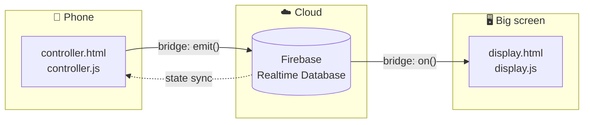

# Architecture Guide

This document explains how the Royal Inauguration System works internally.

## 1. System overview



GitHub Pages only serves the static files. All real-time synchronisation is done by Firebase.

## 2. File responsibilities

| File | Responsibility |
| --- | --- |
| `index.html` | Landing page with links to display and controller |
| `controller.html` + `controller.js` | Remote-control UI; sends commands via `socket.emit()` |
| `display.html` + `display.js` | Stage UI; reacts to commands, runs animations |
| `firebase-config.js` | Defines `window.FIREBASE_CONFIG` |
| `firebase-bridge.js` | Creates `window.io()` – a Socket.IO-compatible object backed by Firebase |
| `gallery.js` | Defines `window.GALLERY_IMAGES` (poster path + participant name) |

## 3. Page load order

Scripts must load in this order, otherwise `io()` is undefined and the controller stays on *Connecting…*:

```text
Firebase App SDK → Firebase Database SDK → firebase-config.js → firebase-bridge.js → gallery.js → page script
```

## 4. The bridge (`firebase-bridge.js`)

`window.io()` returns a `socket` object with:

- `socket.on(event, cb)` – subscribes to an event. For `curtain-state` and `show-image` it also attaches a Firebase listener on the matching `state` child.
- `socket.emit(event, payload)` – updates `state` when relevant, then writes a unique `command` object.
- Built-in `connect` / `disconnect` events driven by Firebase's `.info/connected`.

### Command processing on the receiving side

```text
command changed
   ├─ invalid / no id?          → ignore
   ├─ first value after load?   → remember id, ignore (prevents replaying old commands)
   ├─ same id as last one?      → ignore (duplicate)
   ├─ sent by this client?      → ignore (own command)
   └─ otherwise                 → fire(event, payload)
```

### Navigation uses a transaction

`next-image` / `prev-image` update `currentImageIndex` inside a Firebase **transaction**, so two rapid presses never overwrite each other. The index wraps around using the gallery length.

## 5. Display internals

Layering (bottom → top):

| z-index | Layer |
| --- | --- |
| 1–2 | Golden aura, poster container (blurred backdrop + main image + name) |
| 15 | Left / right curtains |
| 17 | Centre seam |
| 20 | Pelmet (top valance) |
| 29–30 | Flash and golden pulse |
| 35 | Sparkle canvas |
| 40 | Celebration canvas |

The curtain is purely CSS: the `data-state="open|closed"` attribute on `#stage` switches `transform: translateX(...)` transitions on the left and right curtains.

### Changing a poster

```text
goToImage(i)
  ├─ if curtain open → close → wait (transition + buffer)
  ├─ swap image + name
  └─ wait → reopen with fanfare
```

An `imageChangeInProgress` flag prevents overlapping transitions.

### Celebration effects

`launchEffect(type)` dispatches to one of four canvas particle systems (`confetti`, `gold`, `fireworks`, `streamers`). Particles are removed when finished and every effect stops when the curtain closes.

## 6. Firebase data model

```text
smartCurtain
├── command { id, event, payload, sender, timestamp }
└── state   { curtainState, currentImageIndex }
```

See `database.rules.json` for the recommended security rules.
